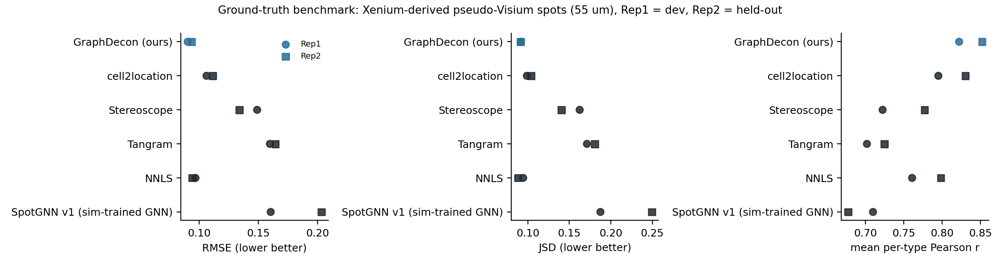

# SpatialTME-AI: A Ground-Truth Benchmark of Spatial Transcriptomics Deconvolution in Breast Cancer

**Project 15 · Husain Naqvi · 2026** · single-cell & spatial omics / tumour microenvironment · [findings write-up](docs/FINDINGS.md) · [figure gallery](https://engr-husainnaqvi.github.io/SpatialTME-AI/) · [live app](https://spatialtme-studio.streamlit.app/)

Visium spots are 55 µm wide and hold several cells, so the cell-type mix of each spot has to be inferred (deconvolution). Most deconvolution benchmarks use simulated spots. This project builds a benchmark from **real tissue with known composition** and asks:

1. Does a **simulation-trained graph neural network** with domain adaptation (SpotGNN, specified in advance) beat simple likelihood models and published methods?
2. Do **spatial smoothing** or **per-gene platform correction** help a likelihood model?
3. Do the rankings hold on a **real Visium section**?

## Data (public: Janesick et al. 2023, GEO GSE243280)

One breast tumour profiled with:
- Xenium (313 genes, two adjacent sections, cell-type labels for each cell);
- Visium CytAssist (4,992 spots);
- 3′ and 5′ single-cell RNA-seq.

**Ground truth.** The labelled Xenium cells inside each Visium-sized spot are summed. This gives pseudo-spots with real tissue structure, real platform effects and known composition (8 cell types).

| Set | Use | Spots |
|---|---|---|
| Xenium replicate 1, 55 / 100 µm | development (every design choice) | 3,576 / 2,029 |
| **Xenium replicate 2, 55 / 100 µm** | **held-out test** | 2,715 / 1,801 |
| Visium, registered to the adjacent Xenium section | real-data check | 3,242 |

## Headline results (held-out replicate 2, 55 µm, 3′ reference)

| Method | RMSE ↓ | Mean per-type r ↑ | Δr vs GraphDecon (block bootstrap 95% CI) |
|---|---|---|---|
| **GraphDecon** (Poisson likelihood on reference profiles) | 0.094 | **0.852** | — |
| cell2location | 0.111 | 0.830 | +0.022 (0.014–0.030) |
| NNLS + platform factors | 0.090 | 0.819 | +0.033 (0.025–0.042) |
| NNLS | 0.094 | 0.798 | +0.053 (0.043–0.065) |
| Stereoscope | 0.134 | 0.777 | +0.074 (0.060–0.088) |
| Tangram | 0.164 | 0.725 | +0.127 (0.116–0.137) |
| **SpotGNN** (simulation-trained GNN + domain adaptation, pre-specified) | 0.203 | 0.678 | +0.174 (0.158–0.190) |
| SpotGNN v2 (post hoc revision) | 0.259 | 0.338 | +0.517 |

- **The pre-specified graph neural network failed.** SpotGNN was below NNLS on every metric. Its ablations show that neither the graph layers (r 0.669 without them) nor the domain adaptation (0.699 without it) helped, and an MLP trained on unstructured simulations did better (0.727). It does not transfer from simulated to real spots.
- **A Poisson likelihood model had the highest per-type correlation** (0.852). It beat cell2location by 0.022 and NNLS by 0.053, and its RMSE equalled NNLS. It gained most on B cells (0.85 vs NNLS 0.65) and myoepithelial cells (0.92 vs 0.75). cell2location was better for tumour (0.98) and perivascular cells. The ranking held at 100 µm and with the 5′ reference (Δr vs cell2location +0.037 and +0.047).
- **Spatial smoothing and platform correction added nothing.**
  - The smoothness weight chosen on replicate 1 was λ = 0, so the final model has no spatial term.
  - The per-gene platform factors were large (median |log factor| 0.66), but removing them changed accuracy by less than 0.003.
  - The gain comes from the count likelihood itself.
- **Real Visium: weak agreement for every method, and a different order.**
  - Expression-based registration to the adjacent Xenium section reached r = 0.56.
  - Mean per-type r: cell2location 0.175, Stereoscope 0.160, GraphDecon 0.153, NNLS 0.129.
  - Only tumour and fibroblast fractions are recovered with any accuracy. Conclusions drawn on Visium without true compositions can differ from those drawn with them.
- **Niches.** Six tumour-microenvironment niches on Visium: tumour core, mixed tumour–stroma, dense stroma, vascular stroma, and two B-cell-rich niches.

## Repository

This public repository holds the write-up, figures and summary result tables (`results/`). The source code (data processing, GraphDecon, SpotGNN, baselines, evaluation) and per-spot predictions are kept in a private repository and are available to reviewers on request. All computation ran on Google Colab (A100 runtime).

## Limitations
- The benchmark uses one tumour and one dataset.
- The ground truth comes from the authors' Xenium cell labels on a 313-gene panel.
- Pseudo-spots sum whole cells.
- The Visium check uses an adjacent section and a partial registration.

## Licence
Copyright © 2026 Husain Naqvi. **All Rights Reserved.** See [LICENSE](LICENSE). The third-party data are not redistributed.
